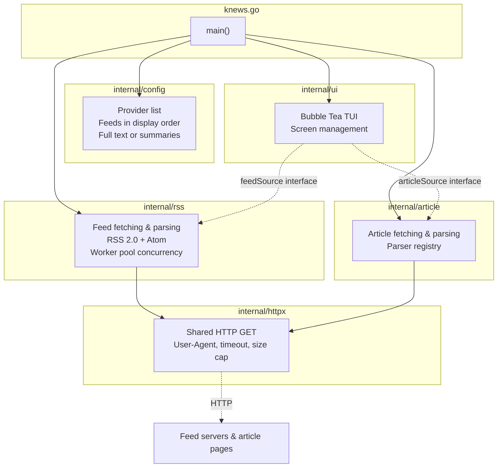
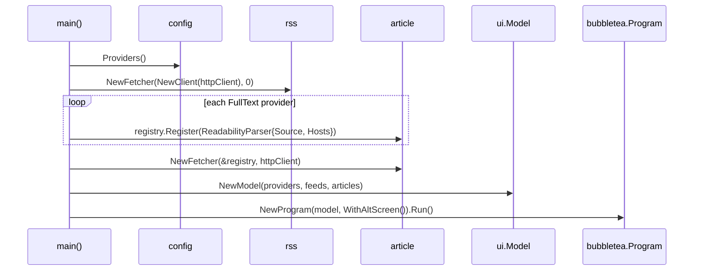
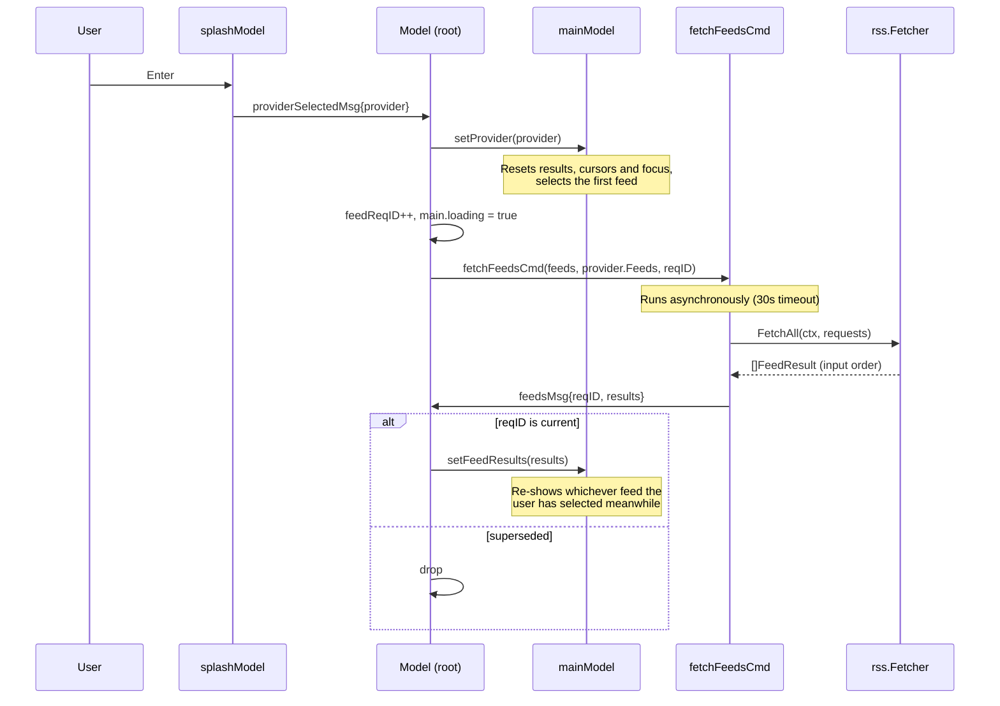
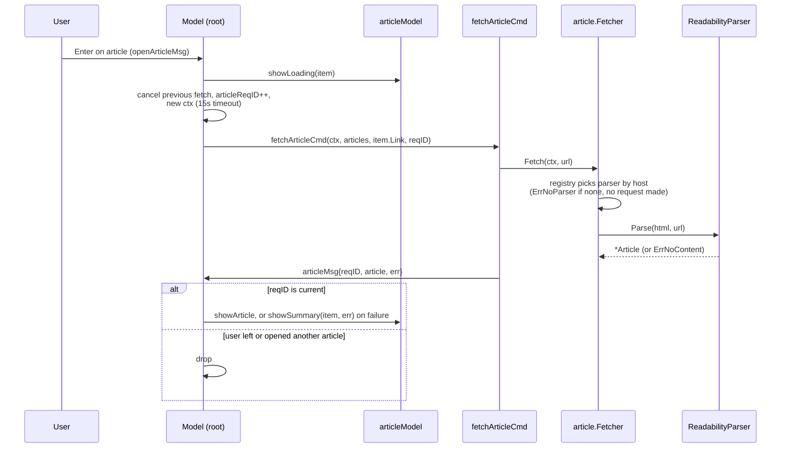
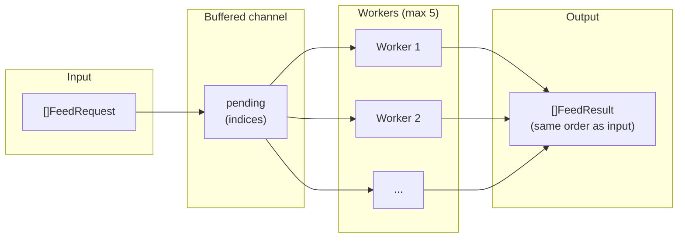
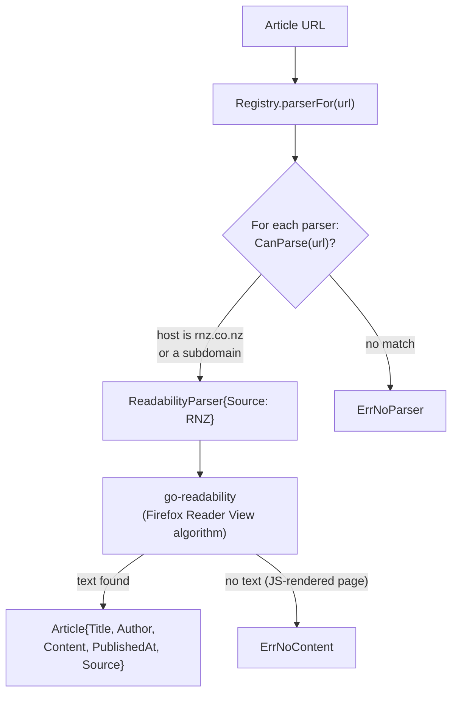
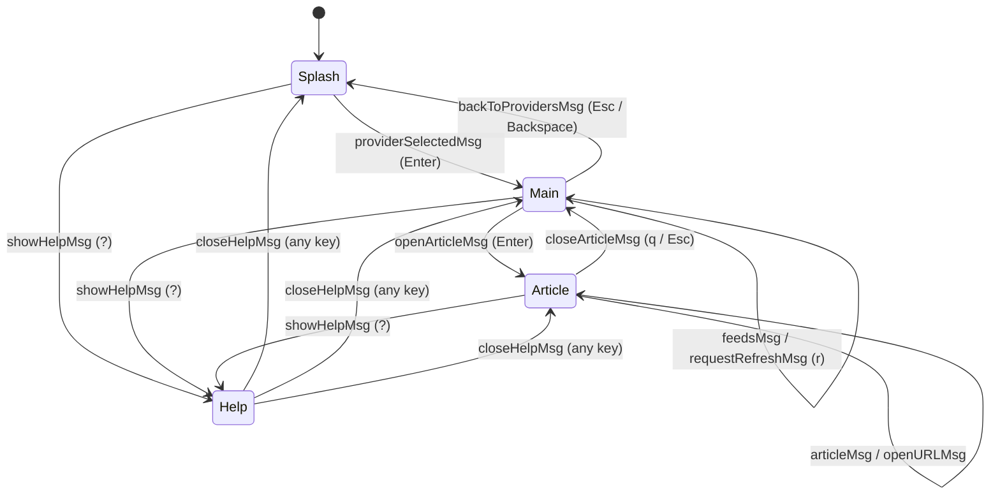

# Knews Architecture

Knews is a terminal-based RSS news reader built in Go using the [Bubble Tea](https://github.com/charmbracelet/bubbletea) TUI framework. It supports RNZ (Radio New Zealand) with full article text, and Stuff and the NZ Herald with headlines and feed summaries. Providers are configuration data, so adding a news site needs no new code.

## Table of Contents

- [High-Level Overview](#high-level-overview)
- [Project Structure](#project-structure)
- [Type Diagram](#type-diagram)
- [Application Lifecycle](#application-lifecycle)
- [RSS Subsystem](#rss-subsystem)
- [Article Parsing Subsystem](#article-parsing-subsystem)
- [UI System](#ui-system)
- [Testing](#testing)

---

## High-Level Overview

The application is organised into five internal packages, each with a single responsibility. The main entry point (`knews.go`) wires them together.



**Package responsibilities:**

| Package | Purpose | Key pattern |
|---------|---------|-------------|
| `config` | Defines providers and their feeds | Static, ordered list |
| `httpx` | One hardened HTTP GET shared by the fetchers | Injectable `*http.Client` |
| `rss` | Fetches and parses RSS 2.0 and Atom feeds concurrently | Worker pool |
| `article` | Fetches article HTML and extracts readable content | Parser registry |
| `ui` | Terminal interface with screen-based navigation | Bubble Tea Model-Update-View |

`ui` doesn't import the concrete fetchers' constructors or read `config` globals: `main` passes it the provider list plus anything satisfying its small `feedSource` / `articleSource` interfaces, which is what lets the UI tests run against fakes.

---

## Project Structure

```
knews/
├── knews.go                    # Entry point — wires all layers together
└── internal/
    ├── config/
    │   └── providers.go        # Feed, Provider, Providers()
    ├── httpx/
    │   └── get.go              # Get(), NewClient() — shared HTTP plumbing
    ├── rss/
    │   ├── types.go            # RSS, Channel, Item (+ Published, Summary), FeedRequest, FeedResult
    │   ├── parser.go           # Parse — RSS/Atom decoding with charset support
    │   ├── client.go           # Client — fetch + parse one feed
    │   ├── fetcher.go          # Fetcher — concurrent worker pool
    │   └── testdata/           # RNZ, Herald (RSS) and Stuff (Atom) feed fixtures
    ├── article/
    │   ├── types.go            # Article struct
    │   ├── parser.go           # Parser interface, Registry
    │   ├── fetcher.go          # Fetcher, ErrNoParser
    │   ├── readability.go      # ReadabilityParser, ErrNoContent
    │   └── testdata/           # Article page fixture
    └── ui/
        ├── model.go            # Root Model — screen routing, request IDs
        ├── commands.go         # Source interfaces, async tea.Cmds & messages
        ├── splash.go           # Provider selection screen
        ├── main_view.go        # Two-panel feed/article listing
        ├── article_view.go     # Scrollable article reader
        ├── help.go             # Keybinding help overlay
        ├── keybindings.go      # Help screen contents
        └── styles.go           # Colour palette & layout helpers
```

---

## Type Diagram

```mermaid
classDiagram
    direction TB

    namespace config {
        class Provider {
            +Name string
            +Description string
            +Hosts []string
            +FullText bool
            +Feeds []Feed
        }
        class Feed {
            +Name string
            +URL string
        }
    }

    namespace rss {
        class Client {
            +Fetch(ctx, url) RSS, error
        }
        class Fetcher {
            -client *Client
            -maxWorkers int
            +FetchAll(ctx, []FeedRequest) []FeedResult
        }
        class RSS {
            +Channel Channel
        }
        class Channel {
            +Title string
            +Items []Item
        }
        class Item {
            +Title, Description, PubDate, Link, GUID, Author string
            +Published() time.Time, bool
            +Summary() string
        }
        class FeedRequest {
            +Name string
            +URL string
        }
        class FeedResult {
            +FeedRequest
            +Feed RSS
            +Err error
        }
    }

    namespace article {
        class Parser {
            <<interface>>
            +CanParse(url) bool
            +Parse(html, url) *Article, error
        }
        class Registry {
            -parsers []Parser
            +Register(Parser)
        }
        class ArticleFetcher["Fetcher"] {
            -registry *Registry
            +Fetch(ctx, url) *Article, error
        }
        class ReadabilityParser {
            +Source string
            +Hosts []string
        }
        class Article {
            +URL, Title, Author, Content, Source string
            +PublishedAt time.Time
        }
    }

    Provider *-- Feed
    RSS *-- Channel
    Channel *-- Item
    Fetcher --> Client : uses
    FeedResult *-- FeedRequest
    FeedResult *-- RSS

    ReadabilityParser ..|> Parser : implements
    Registry o-- Parser : contains
    ArticleFetcher --> Registry : uses
    ArticleFetcher ..> Article : returns
```



---

## Application Lifecycle

### Startup

`main()` builds one `http.Client` (30s timeout) and shares it between the feed and article fetchers. It registers one `ReadabilityParser` per provider with `FullText: true`, using the provider's `Hosts`, then hands the provider list and both fetchers to `ui.NewModel`.



### Provider Selection → Feed Loading



Refresh (`r`) goes through the same path with `refresh: true`, which adds a "Feeds refreshed" notice. A refresh is ignored while a fetch is already in flight.

### Article Selection → Content Display

For providers with `FullText: false` (Stuff, NZ Herald), opening an article makes no request at all: the root model builds an `Article` from the feed item (`summaryArticle`: title, author, date, plain-text summary) and shows it with a note offering `o` to open the page in a browser. For full-text providers:



Leaving the article view (`q`/`Esc`) cancels the in-flight fetch and bumps `articleReqID`, so a late result can never overwrite a newer article.

---

## RSS Subsystem

### Worker Pool



**Key design decisions:**

- **Index-based channel**: The channel carries request indices. Each worker writes only the result slots it takes, so results come back in input order with no further locking.
- **Pre-filled results**: Every slot's `FeedRequest` is filled in before the workers start, so each result always carries its feed's name and URL.
- **Context cancellation**: Workers keep draining the channel after `ctx` is done, setting `Err = ctx.Err()` for every remaining request instead of fetching it. No result is ever left blank.
- **Worker count**: `min(maxWorkers, len(requests))`, started with `sync.WaitGroup.Go`.

### Parsing

`rss.Parse` reads the root element and decodes `<rss>` documents directly or `<feed>` (Atom) documents via `atomFeed.toRSS()`, which maps `summary` → `Description`, `published` (else `updated`) → `PubDate`, the alternate `link` → `Link` and author names → `Author`. Any other root is an error, so a feed in an unexpected format fails loudly instead of showing as empty. RSS `dc:creator` fills `Author`. Non-UTF-8 feeds are converted using their XML declaration.

`Item.Published()` parses RFC 822 dates (one- or two-digit days) and ISO 8601. `Item.Summary()` strips HTML from the description and collapses whitespace.

---

## Article Parsing Subsystem



`CanParse` compares the URL's parsed host, so `https://evil.example/?u=rnz.co.nz` doesn't match.

**Adding a news source:** add a `Provider` to `internal/config/providers.go` with its `Feeds` (RSS 2.0 or Atom).

- If the site serves article text as plain HTML, set `FullText: true` and its `Hosts`. `main` registers a `ReadabilityParser` for it automatically.
- If it doesn't (client-side rendering, a paywall), leave `FullText` false and readers get the feed summary.
- For a site readability handles badly but which does serve its text, write a type implementing `article.Parser` and register it in `main()`.

Even for full-text providers, if a fetch fails (network error, `ErrNoContent`, `ErrNoParser`), the UI falls back to the summary and shows the error.

---

## UI System

The UI uses Bubble Tea's **Model-Update-View** architecture. The root `Model` owns one sub-model per screen and routes messages to the active one.

### Screen State Machine



Help returns to whichever screen opened it. `Ctrl+C` quits from every screen; `q` quits from the splash and main screens. The `bubbles/list` built-in quit keys are disabled so `Esc` never quits. Going back to the provider list bumps `feedReqID`, so an in-flight fetch for the old provider is dropped. Picking a provider resets the feed results, cursors and focus.

### Main View Layout

```
╭──────────────────────────────────────────────────────╮
│                    Knews - RNZ                       │  ← Header (provider name)
╰──────────────────────────────────────────────────────╯
╭─ Feeds ────────────╮╭─ Business ─────────────────────╮
│ Business           ││ Article title here             │  ← feedList / articleList
│ Environment        ││   02 Apr 2026                  │    (bubbles/list, custom delegates)
│ National           ││ Another article title that ... │  ← titles truncated to fit
│ World              ││   01 Apr 2026                  │
╰────────────────────╯╰────────────────────────────────╯
 Press ? for help │ Esc providers │ q to quit             ← Status bar
```

The status bar is derived from state on every render: "Loading feeds..." while a fetch is in flight, otherwise the current feed's error if it has one, otherwise the help hint (plus a transient notice such as "Feeds refreshed").

### Message Types

| Message | Trigger | Effect |
|---------|---------|--------|
| `providerSelectedMsg` | Enter on splash | Reset main view, fetch feeds, switch to main |
| `backToProvidersMsg` | `Esc` / `Backspace` on main | Drop in-flight feed fetch, return to splash |
| `feedsMsg` | Feed fetch completes | Store results if `reqID` is current |
| `requestRefreshMsg` | `r` | Re-fetch feeds unless already loading |
| `openArticleMsg` | Enter on article | Show summary, or show loading and start fetch (full-text providers) |
| `articleMsg` | Article fetch completes | Show article, or summary + error, if `reqID` is current |
| `openURLMsg` | Browser launch finishes | Show an error notice if it failed |
| `closeArticleMsg` | `q` / `Esc` in article | Cancel fetch, return to main |
| `showHelpMsg` / `closeHelpMsg` | `?` / any key | Enter / leave help |

---

## Testing

```sh
go test -race ./...
```

- **`httpx`, `rss`, `article`** use `httptest.Server` via the injectable `*http.Client`. They cover status errors, deadlines, worker-pool ordering, the concurrency limit and cancellation. Fixtures live in each package's `testdata/`.
- **`config`** checks that provider and feed names are unique and that every URL is a valid https URL.
- **`ui`** drives the root model with synthetic key messages and fake `feedSource` / `articleSource` implementations, running each returned command the way Bubble Tea would. It includes regression tests for quitting, stale results, cursor handling and layout. `TestViewFillsWindow` asserts that every screen exactly fills the terminal at several sizes.
