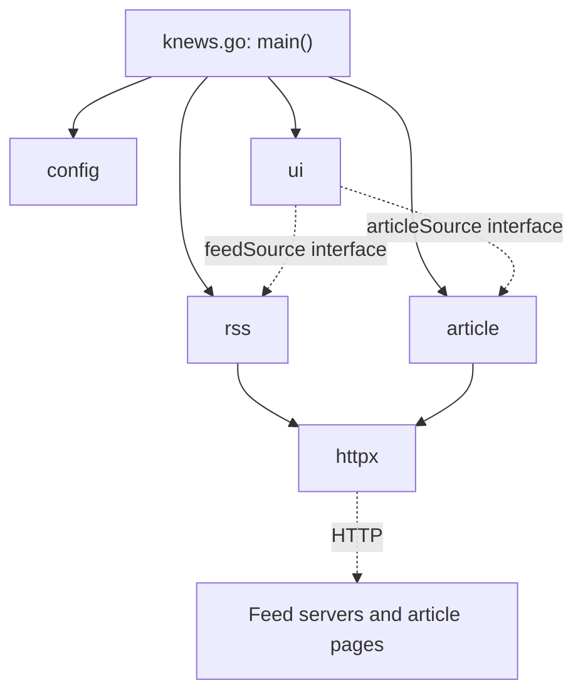
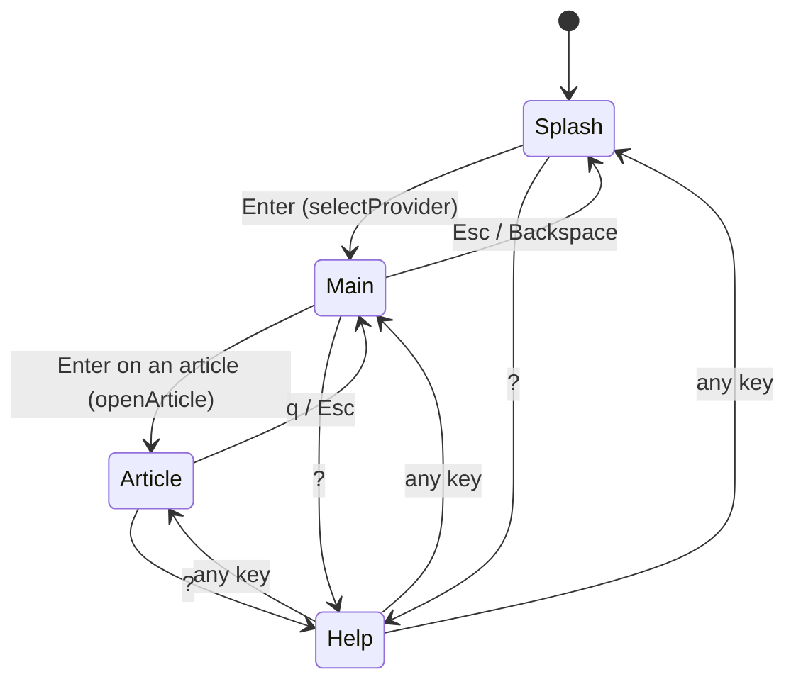

# Knews Architecture

Knews is a terminal-based RSS news reader built in Go using the [Bubble Tea](https://github.com/charmbracelet/bubbletea) TUI framework. It supports RNZ (Radio New Zealand) with full article text, and Stuff and the NZ Herald with headlines and feed summaries. Providers are configuration data, so adding a news site needs no new code.

The codebase aims to be easy to read for beginners while staying idiomatic Go: plain structs and slices, the standard patterns (`switch`, `if err := …; err != nil`, `sync.WaitGroup.Go`), and no abstractions that only have one implementation.

## Table of Contents

- [High-Level Overview](#high-level-overview)
- [Project Structure](#project-structure)
- [Application Lifecycle](#application-lifecycle)
- [RSS Subsystem](#rss-subsystem)
- [Article Subsystem](#article-subsystem)
- [UI System](#ui-system)
- [Testing](#testing)

---

## High-Level Overview

The application is organised into five internal packages, each with a single responsibility. The main entry point (`knews.go`) wires them together.



| Package | Purpose |
|---------|---------|
| `config` | Defines providers and their feeds as a plain list |
| `httpx` | One HTTP GET (User-Agent, timeout, size cap) shared by the fetchers |
| `rss` | Fetches and parses RSS 2.0 and Atom feeds; fetches many concurrently |
| `article` | Fetches article pages and extracts readable text |
| `ui` | The terminal interface (one Bubble Tea model for every screen) |

`ui` only knows the two small `feedSource` / `articleSource` interfaces, which exist so the UI tests can use fakes. `main` passes it the real `*rss.Fetcher` and `*article.Fetcher`.

---

## Project Structure

```
knews/
├── knews.go                    # Entry point: wires everything together
└── internal/
    ├── config/
    │   └── providers.go        # Feed, Provider, Providers()
    ├── httpx/
    │   └── get.go              # Get(), NewClient()
    ├── rss/
    │   ├── types.go            # Feed, Item (+ Published, Summary), FeedRequest, FeedResult
    │   ├── parser.go           # Parse: RSS 2.0 and Atom decoding, charset support
    │   ├── fetcher.go          # Fetcher: Fetch one feed, FetchAll with a worker pool
    │   └── testdata/           # RNZ, Herald (RSS) and Stuff (Atom) feed fixtures
    ├── article/
    │   ├── article.go          # Article, HostRule (optional Extract), Fetcher, matchesHost, Extract
    │   └── testdata/           # Article page fixture
    └── ui/
        ├── model.go            # Model: state, Update (routing), View, screen changes
        ├── commands.go         # Background commands (fetch feeds/article, open browser)
        ├── splash.go           # Provider selection screen
        ├── main_view.go        # Two-panel feed/article lists with scrolling
        ├── article_view.go     # Scrollable article reader (bubbles/viewport)
        ├── help.go             # Keybinding help screen
        ├── list.go             # listCursor: list keys, cursor and scrolling
        └── styles.go           # Colours, titledBox, keyHint, truncateString
```

---

## Application Lifecycle

### Startup

`main()` builds one `http.Client` (30s timeout) and shares it between the feed and article fetchers. It creates one `article.HostRule` for each provider with `FullText: true`, using the provider's `Hosts`, then hands the provider list and both fetchers to `ui.NewModel`.

### Provider Selection → Feed Loading

1. On the splash screen, the list keys move `providerList`; `Enter` calls `Model.selectProvider`.
2. `selectProvider` stores the provider, resets the main screen's state, switches to `screenMain` and calls `fetchFeeds`.
3. `fetchFeeds` bumps `feedReqID`, sets `main.loading` and returns `fetchFeedsCmd`, which runs `FetchAll` in the background (30s timeout).
4. When it finishes, `Update` receives a `feedsMsg`. If its `reqID` is not the current `feedReqID` the user has moved on, so it is dropped. Otherwise the results are stored by feed name.

Refresh (`r`) goes through `fetchFeeds(true)`, which adds a "Feeds refreshed" notice. A refresh is ignored while a fetch is already in flight.

### Article Selection → Content Display

`Model.openArticle` switches to `screenArticle`.

- For providers with `FullText: false` (Stuff, NZ Herald) no request is made. The article is built from the feed item (`summaryArticle`: title, author, date, plain-text summary) with a note offering `o` to open the page in a browser.
- For full-text providers it shows "Loading article...", bumps `articleReqID`, creates a 15s context and runs `fetchArticleCmd`. The resulting `articleMsg` is dropped if its `reqID` is stale. On success the article is shown; on any error the feed summary is shown together with the error.

Leaving the article (`q`/`Esc`) calls `stopArticleFetch`, which cancels the fetch and bumps `articleReqID`, so a late result can never overwrite a newer article.

---

## RSS Subsystem

### Parsing

`rss.Parse` reads the root element and decodes `<rss>` documents (via the unexported `rssDocument` types) or `<feed>` (Atom) documents (via `atomFeed`). Both are converted to the same `Feed{Title, Items}`, so the rest of knews handles one format. Any other root is an error, so a feed in an unexpected format fails loudly instead of showing as empty. Non-UTF-8 feeds are converted using their XML declaration.

Atom mapping: `summary` → `Description`, `published` (else `updated`) → `PubDate`, the alternate `link` → `Link`, author names → `Author`. RSS `dc:creator` fills `Author`.

`Item.Published()` parses RFC 822 dates (one- or two-digit days) and ISO 8601. `Item.Summary()` strips HTML from the description and collapses whitespace.

### Fetcher and Worker Pool

`Fetcher.Fetch(ctx, url)` downloads and parses one feed. `Fetcher.FetchAll(ctx, requests)` fetches many at once:

- The indices of the requests are put on a buffered channel; up to `MaxWorkers` (default 5, never more than there are requests) goroutines take indices from it.
- Each worker writes only to the result slots it takes, so results come back in input order with no locking.
- Every result's `Name` and `URL` are filled in before the workers start, so a failed result still says which feed it is for.
- If `ctx` is done, workers keep draining the channel, setting `Err = ctx.Err()` for each remaining request instead of fetching it. No result is ever left blank.

---

## Article Subsystem

`article.Fetcher` is created with a list of `HostRule{Source, Hosts}`. `Fetch(ctx, url)`:

1. Looks for a rule whose hosts match the URL (`matchesHost`). If none matches it returns `ErrUnsupportedHost` without making a request.
2. Downloads the page with `httpx.Get`.
3. Calls the rule's `Extract` function if it has one, otherwise the package's `Extract(html, url, source)`, which runs [go-readability](https://codeberg.org/readeck/go-readability) (the algorithm behind Firefox's Reader View) and returns an `Article`, or `ErrNoContent` if the page has no text (for example JavaScript-rendered pages).

`matchesHost` compares the URL's parsed host (a host matches itself and its subdomains), so `https://evil.example/?u=rnz.co.nz` doesn't match `rnz.co.nz`.

**Adding a news source:** add a `Provider` to `internal/config/providers.go` with its `Feeds` (RSS 2.0 or Atom).

- If the site serves article text as plain HTML, set `FullText: true` and its `Hosts`. `main` creates the host rule automatically.
- If it doesn't (client-side rendering, a paywall), leave `FullText` false and readers get the feed summary.
- For a site readability handles badly but which does serve its text, write a function with the same signature as `article.Extract` and set it as that host rule's `Extract` in `main()`.

---

## UI System

The UI uses Bubble Tea's Model-Update-View architecture with a **single root `Model`** that holds the state of every screen. `Update` handles a message and `View` draws whichever screen is active.

### Screens



Help returns to whichever screen opened it (`helpReturn`).

### How a key press is handled

`Model.handleKey` in `model.go` is the one place to start reading:

1. `Ctrl+C` quits, whatever the screen.
2. On the help screen, any key goes back to `helpReturn`.
3. `?` opens help.
4. Otherwise the key goes to `updateSplash`, `updateMain` or `updateArticle`, depending on `activeScreen`.

Screen changes are plain assignments (`m.activeScreen = screenMain`). Bubble Tea commands are only used for work that takes time.

### Background messages

| Message | Started by | Effect |
|---------|-----------|--------|
| `feedsMsg` | `fetchFeedsCmd` | Store the results if `reqID` is current |
| `articleMsg` | `fetchArticleCmd` | Show the article, or summary + error, if `reqID` is current |
| `openURLMsg` | `openURLCmd` | Show an error notice if the browser failed to launch |

### Lists and scrolling

The provider, feed and article lists are plain slices drawn with `for` loops. Each list keeps a `listCursor` (in `list.go`): a **cursor** (the highlighted row) and an **offset** (the first row drawn). `listCursor.handleKey` handles the list keys for all three lists: `j`/`k`/arrows, `d`/`u`/`f`/`b`/PgDn/PgUp (a screenful) and `g`/`G`/Home/End (top/bottom). It then scrolls the minimum needed to keep the cursor visible (`adjustScrollOffset`). `syncMainScroll` re-scrolls both main panels after a list change or resize, using `feedRowsVisible` / `articleRowsVisible` as the page sizes. An empty list shows "No items.". `bubbles/viewport` is used only for the article text.

### Main View Layout

```
╭──────────────────────────────────────────────────────╮
│                    Knews - RNZ                       │  ← Header (provider name)
╰──────────────────────────────────────────────────────╯
╭─ Feeds ────────────╮╭─ Business ─────────────────────╮
│ Business           ││ Article title here             │  ← feeds / articles
│ Environment        ││   02 Apr 2026                  │
│ National           ││ Another article title that ... │  ← titles truncated to fit
│ World              ││   01 Apr 2026                  │
╰────────────────────╯╰────────────────────────────────╯
 Press ? for help │ Esc providers │ q to quit             ← Status bar
```

The status bar is derived from state on every render: "Loading feeds..." while a fetch is in flight, otherwise the current feed's error if it has one, otherwise the help hint (plus a transient notice such as "Feeds refreshed").

---

## Testing

```sh
go test -race ./...
```

- **`httpx`, `rss`, `article`** use `httptest.Server`. They cover status errors, deadlines, worker-pool ordering, the concurrency limit and cancellation. Fixtures live in each package's `testdata/`.
- **`config`** checks that provider and feed names are unique and that every URL is a valid https URL.
- **`ui`** drives the root model with synthetic key messages and fake `feedSource` / `articleSource` implementations, running each returned command the way Bubble Tea would. It includes regression tests for quitting, stale results, cursor handling, list scrolling and layout. `TestViewFillsWindow` asserts that every screen exactly fills the terminal at several sizes.
