# Knews Architecture

Knews is a terminal-based RSS news reader built in Go using the [Bubble Tea](https://github.com/charmbracelet/bubbletea) TUI framework. It currently supports RNZ (Radio New Zealand) feeds, with an extensible design for adding more providers.

## Table of Contents

- [High-Level Overview](#high-level-overview)
- [Project Structure](#project-structure)
- [Type Diagram](#type-diagram)
- [Application Lifecycle](#application-lifecycle)
- [RSS Subsystem](#rss-subsystem)
- [Article Parsing Subsystem](#article-parsing-subsystem)
- [UI System](#ui-system)
- [Full Data Flow](#full-data-flow)

---

## High-Level Overview

The application is organised into four internal packages, each with a single responsibility. The main entry point (`knews.go`) wires them together.

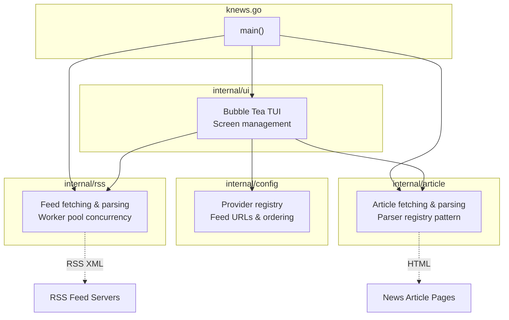

**Package responsibilities:**

| Package | Purpose | Key pattern |
|---------|---------|-------------|
| `config` | Defines providers, feed URLs, and display ordering | Static registry |
| `rss` | Fetches and parses RSS XML feeds concurrently | Worker pool |
| `article` | Fetches full article HTML and extracts readable content | Parser registry |
| `ui` | Terminal interface with screen-based navigation | Bubble Tea Model-Update-View |

---

## Project Structure

```
knews/
├── knews.go                    # Entry point — wires all layers together
└── internal/
    ├── config/
    │   ├── types.go            # Provider, FeedConfiguration structs
    │   ├── feeds.go            # RNZ provider definition & feed URLs
    │   └── config.go           # Test configuration helper
    ├── rss/
    │   ├── types.go            # Rss, Channel, Item, FeedResult, FeedRequest
    │   ├── client.go           # FeedClient — HTTP fetch + XML parse
    │   ├── parser.go           # ParseXmlResponse — XML unmarshalling
    │   └── fetcher.go          # FeedFetcher — concurrent worker pool
    ├── article/
    │   ├── types.go            # Article struct
    │   ├── parser.go           # ArticleParser interface, ParserRegistry, ArticleFetcher
    │   └── rnz_parser.go       # RNZParser — go-readability based extraction
    └── ui/
        ├── model.go            # Root Model — screen routing & message dispatch
        ├── commands.go         # Async tea.Cmd functions & message types
        ├── splash.go           # Provider selection screen
        ├── main_view.go        # Two-panel feed/article listing
        ├── article_view.go     # Scrollable article reader
        ├── help.go             # Keybinding help overlay
        ├── styles.go           # Colour palette & layout helpers
        └── keybindings.go      # Key definitions & descriptions
```

---

## Type Diagram

All key types and their relationships across packages:

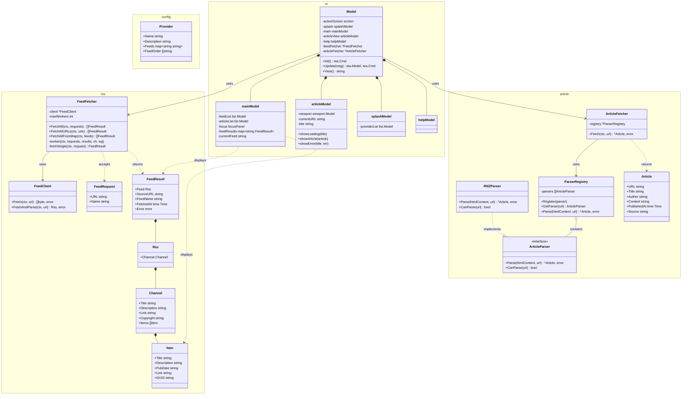

---

## Application Lifecycle

### Startup Sequence

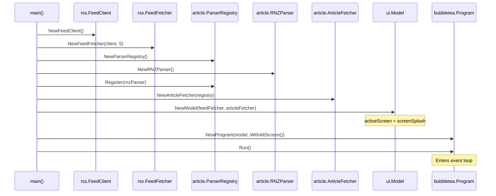

### Provider Selection → Feed Loading

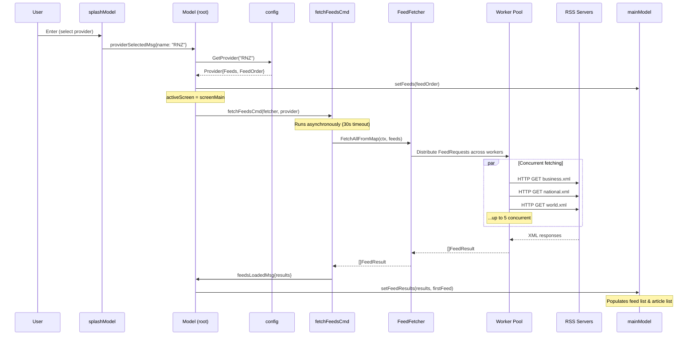

### Article Selection → Content Display

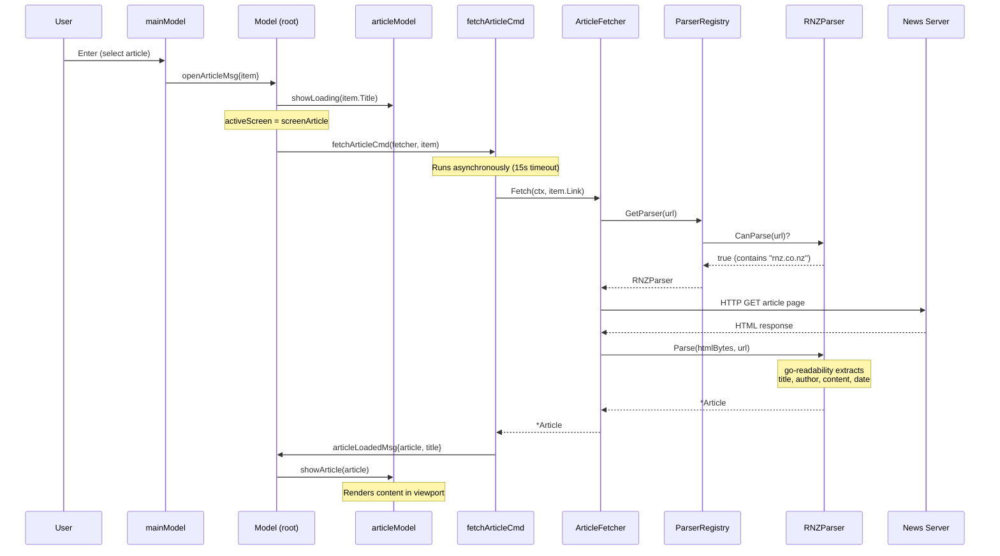

### Feed Refresh

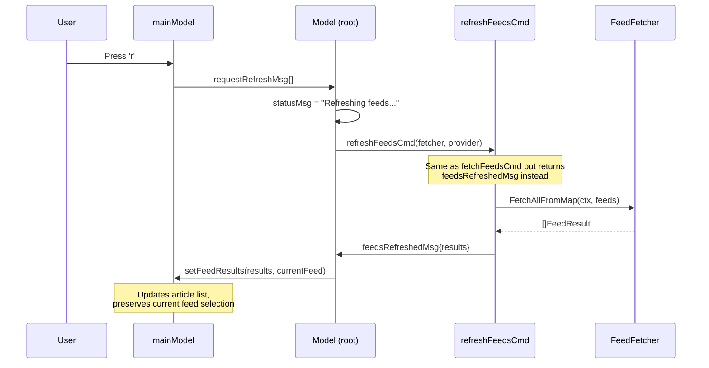

---

## RSS Subsystem

The RSS subsystem handles fetching and parsing RSS XML feeds with controlled concurrency.

### Worker Pool Architecture

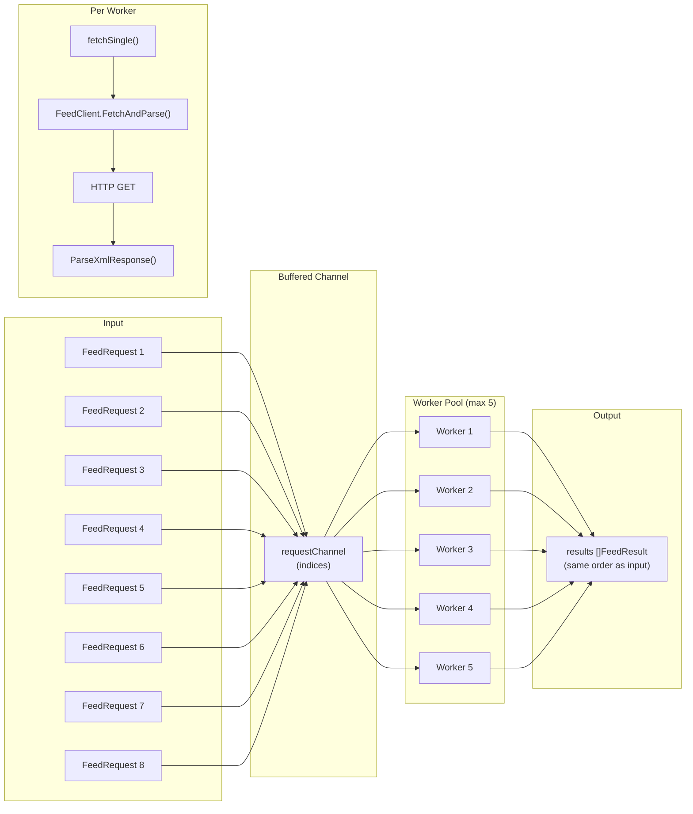

**Key design decisions:**

- **Index-based channel**: The channel carries request indices, not requests. Workers read from the shared `requests` slice and write to the shared `results` slice at matching indices, preserving input order.
- **Context cancellation**: Each worker checks `ctx.Done()` before processing the next request. If the context is cancelled (e.g. timeout), remaining results are filled with the context error.
- **Worker count**: `min(maxWorkers, len(requests))` — never spawns more goroutines than there are requests.

### RSS Data Flow

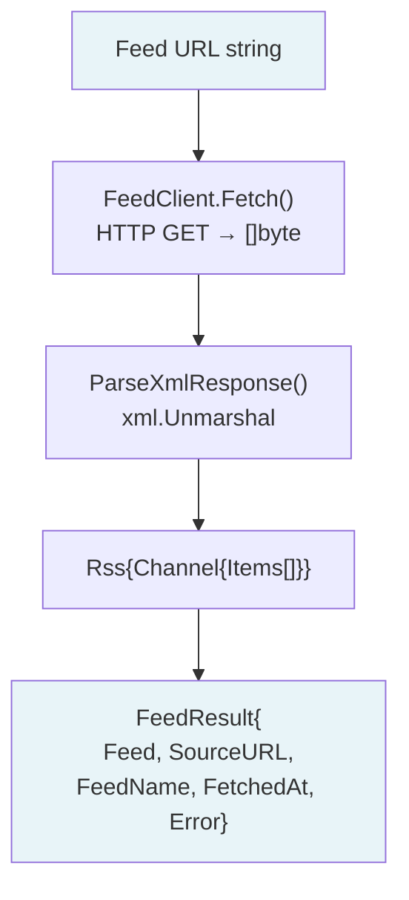

---

## Article Parsing Subsystem

The article subsystem uses the **registry pattern** to support multiple news sources. Each source gets its own parser implementation; the registry dispatches to the right one based on URL.

### Parser Registry Pattern

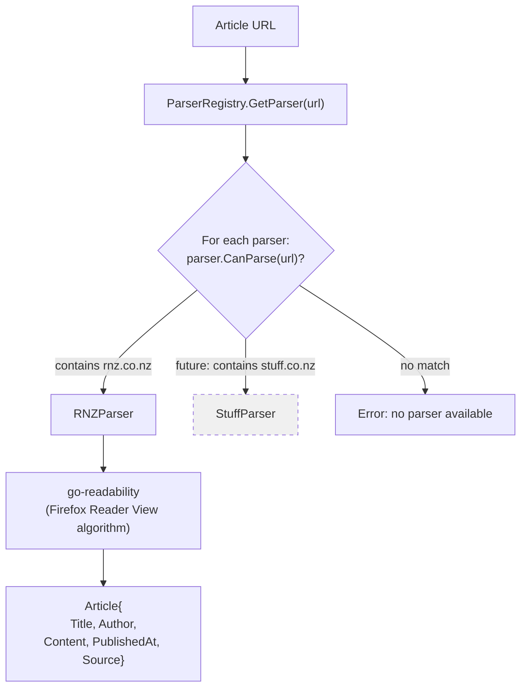

### Article Fetch Sequence

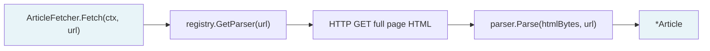

**Adding a new news source** requires just two steps:
1. Create a struct implementing `ArticleParser` (the `Parse` and `CanParse` methods)
2. Register it in `main()`: `parserRegistry.Register(NewMyParser())`

---

## UI System

The UI uses Bubble Tea's **Model-Update-View** (MVU) architecture — a unidirectional data flow pattern where the model is the single source of truth.

### Screen State Machine

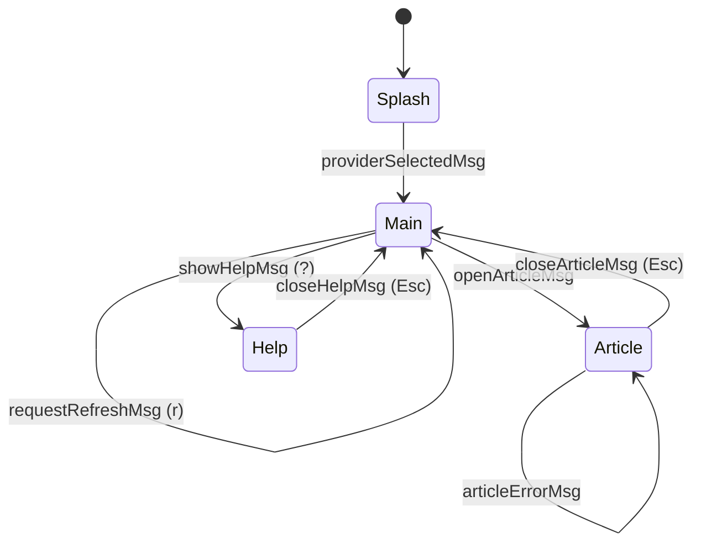

### Bubble Tea Update Loop

Every interaction in the UI follows this cycle:

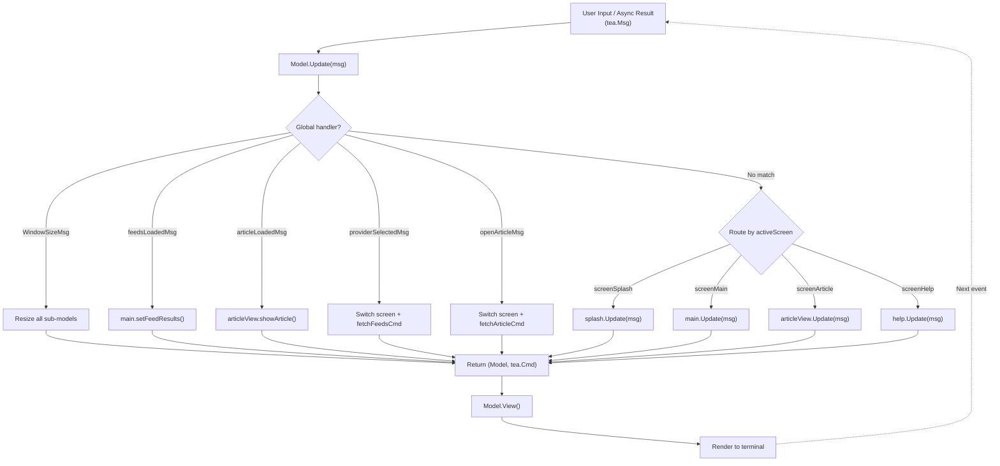

### Main View Layout

The main screen uses a two-panel layout with focus management:

```
┌──────────────────────────────────────────────────────┐
│                Knews - NZ News Reader                │  ← Header (titledBox)
├────────────────────┬─────────────────────────────────┤
│      Feeds         │         Articles                │
│  ┌──────────────┐  │  ┌───────────────────────────┐  │
│  │ ▸ Business   │  │  │ ▸ Article title here      │  │  ← feedList / articleList
│  │   Country    │  │  │     02 Apr 2026           │  │    (bubbles/list)
│  │   National   │  │  │   Another article         │  │
│  │   World      │  │  │     01 Apr 2026           │  │
│  │   ...        │  │  │   ...                     │  │
│  └──────────────┘  │  └───────────────────────────┘  │
│  (22 chars wide)   │  (remaining width)              │
├────────────────────┴─────────────────────────────────┤
│ Press ? for help │ q to quit                         │  ← Status bar
└──────────────────────────────────────────────────────┘
```

- **Tab / h / l**: Toggle focus between feed list and article list
- **j / k**: Navigate within the focused list
- **Enter**: Select feed (from feed list) or open article (from article list)
- Active panel border is highlighted in dark cyan; inactive is gray

### Message Types

| Message | Trigger | Effect |
|---------|---------|--------|
| `providerSelectedMsg` | Enter on splash | Load feeds, switch to main screen |
| `feedsLoadedMsg` | Async feed fetch completes | Populate feed results |
| `feedsRefreshedMsg` | Async refresh completes | Update feed results, preserve selection |
| `openArticleMsg` | Enter on article item | Show loading, switch to article screen |
| `articleLoadedMsg` | Async article fetch completes | Render article in viewport |
| `articleErrorMsg` | Async article fetch fails | Show error message |
| `showHelpMsg` | Press `?` | Switch to help screen |
| `closeArticleMsg` | Press `Esc` on article | Return to main screen |
| `closeHelpMsg` | Press `Esc` on help | Return to main screen |
| `requestRefreshMsg` | Press `r` | Re-fetch all feeds |

---

## Full Data Flow

End-to-end flow from startup to reading an article:

```mermaid
graph TB
    subgraph "1. Startup"
        Main["main()"] --> Wire["Wire FeedClient → FeedFetcher<br/>Wire RNZParser → Registry → ArticleFetcher"]
        Wire --> UI["Create Model, run bubbletea"]
    end

    subgraph "2. Provider Selection"
        UI --> Splash["Splash screen<br/>User picks 'RNZ'"]
        Splash --> Config["config.GetProvider('RNZ')<br/>→ 8 feed URLs + ordering"]
    end

    subgraph "3. Feed Fetching"
        Config --> FetchCmd["fetchFeedsCmd<br/>(30s timeout)"]
        FetchCmd --> Pool["FeedFetcher worker pool<br/>up to 5 concurrent HTTP GETs"]
        Pool --> XMLParse["ParseXmlResponse<br/>for each feed"]
        XMLParse --> Results["[]FeedResult<br/>with Rss → Channel → []Item"]
    end

    subgraph "4. Feed Display"
        Results --> MainView["mainModel<br/>Feed list (left) + Article list (right)"]
        MainView --> Browse["User browses feeds & articles<br/>Tab/h/l to switch panels, j/k to navigate"]
    end

    subgraph "5. Article Reading"
        Browse --> Select["User presses Enter on article"]
        Select --> ArtCmd["fetchArticleCmd<br/>(15s timeout)"]
        ArtCmd --> ArtFetch["ArticleFetcher.Fetch()<br/>HTTP GET → HTML"]
        ArtFetch --> Parse["RNZParser.Parse()<br/>go-readability extraction"]
        Parse --> ArtView["articleModel viewport<br/>Title, author, date, content"]
    end

    style Main fill:#e8f4f8
    style ArtView fill:#e8f4f8
```
